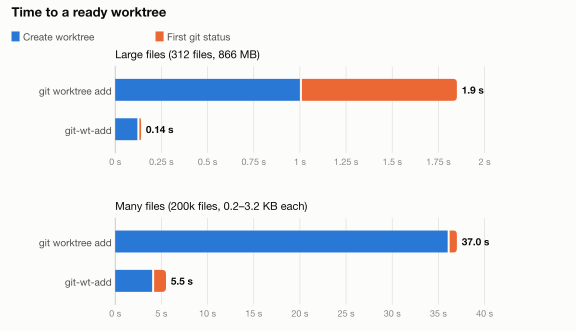

# git-wt-add

Create a git worktree that's (usually) ready to work in straight away.

This makes use of APFS's copy-on-write functionality. This allows us to create a new file, but, only duplicating the metadata initially. This gives us two primary benefits:

1. **Speed** - We're still somewhat I/O bound for copying across the metadata about a file, but for situations where you have many large files (hello game developers!) this is far faster
2. **Disk space** - Copy on write deduplicates files until you write to them. This means that if your initial checkout is 20gb (again, hello game developers) using copy on write means you only pay for exactly what's changed

I've implemented this targeting APFS, given Linux people probably already have many ways to do this :) It's a single file Swift program - when compiled with `swiftc` you should just get a ~120k binary out.

## Benchmarks

This is time for creating a worktree + first `git status` in it. As you see, this script is far faster than vanila `git worktree add`!

| Test | `git worktree add` | then `git status` | `git-wt-add` | then `git status` |
|---|---|---|---|---|
| Large files (312 files, 866 MB) | 0.75–1.25 s | 0.5–1.2 s | **0.12 s** | 0.02 s |
| Many files (200k files, 0.2-3.2KB each) | 36 s | 1.0 s | **~4.0 s** | ~1.5 s |

<picture>
  <source media="(prefers-color-scheme: dark)" srcset="docs/benchmarks-dark.svg">
  
</picture>

## Build from source

0. Make sure you have a Swift toolchain installed. Xcode's will suffice.
1. `./build.sh` -> This is just a simple wrapper for `swiftc` with optimisations
2. Move `./git-wt-add` somewhere on your system PATH :D

## Usage

    git-wt-add PATH REF [-b NEWBRANCH] [--source DIR] [--copy REL]...

- `PATH`: the new worktree path. this shouldn't exist.
- `REF`: the branch, tag or commit to check out
- `-b NEWBRANCH`: create a new branch at REF
- `--source DIR`: the worktree to clone from. by default it will use the main worktree for your repo
- `--copy REL`: also clone some other path. helpful if you have some huge cache on hand! nb: this is relative to the checkout root

By default, we generally try to match `git worktree add PATH REF` (e.g. you get files tracked at REF and nothing else). But, for many projects the main cost of a new worktree is importing assets, installing packages, etc.

Consider if you are working with a Unity project and have a `UserSettings` and `Library` folder you want to bring with. In this scenario, you can run the following:

    git-wt-add ../feature main --copy UserSettings --copy Library

This will result in a significantly faster worktree clone, and you have a project that's ready to import straight away.

> NOTE!!! `--copy .venv` won’t clone the venv, due to oddities about how venvs are created. If `uv` and `pyproject.toml` are present **AND** you try to copy `.venv`, we'll attempt to build a fresh venv with `uv sync --frozen` instead. If you don't have a `uv.lock`, this will fail (and fail the worktree creation).

